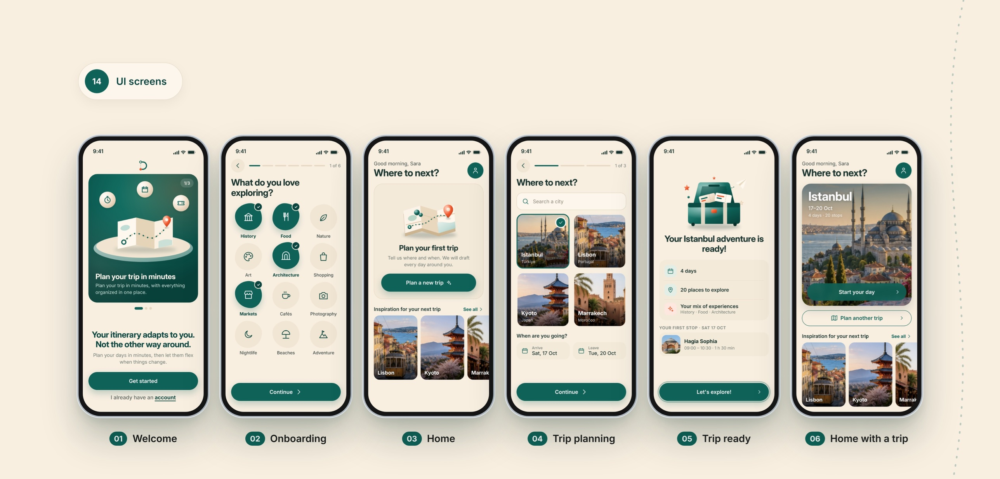
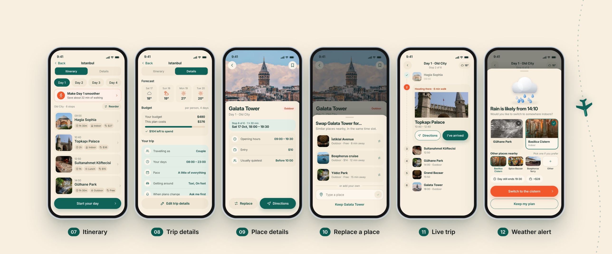
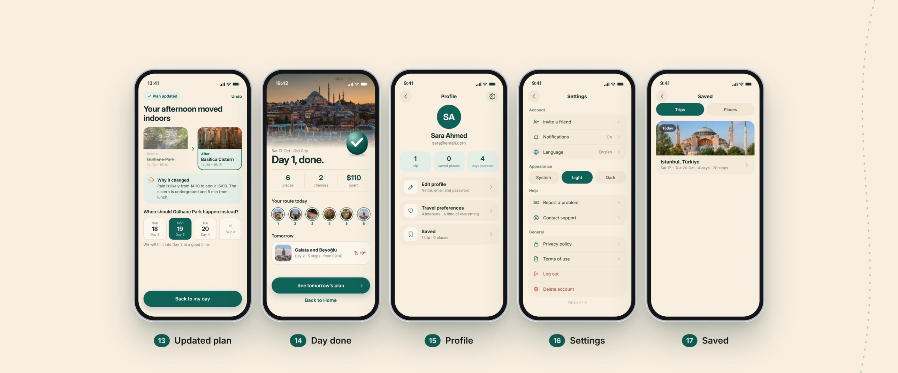

<div align="center" style="margin-bottom: 30px;">

# Detour 🧭🗺️

**Your itinerary adapts to you. Not the other way around.**

</div>

---

## 📍 About Detour 📍
Detour is a friendly mobile travel-planner prototype. Tell it where and when you're going and what you love, and it drafts every day of your trip around you. When the weather turns or a place is closed, Detour suggests a smarter plan so your day stays on track.

---

## 🌟 Key Features

- **Personalized Trips** 🎯: Pick your interests (history, food, markets, architecture and more) and get a plan built around them
- **Day-by-Day Itinerary** 🗓️: Every stop with time, duration, category and price
- **Smoother Days** 🚶: Reorder stops and save walking time with one tap
- **Weather Alerts** 🌧️: Rain on the way? Switch to an indoor alternative in a tap
- **Replace a Place** 🔄: Swap any stop for similar nearby places or add your own
- **Live Trip Mode** 📍: Follow your day stop by stop with directions and "I've arrived"
- **Budget & Forecast** 💰☀️: See what your plan costs and what the weather will do
- **Saved Trips & Profile** 🔖: Keep your trips, preferences and settings in one place

---

## 💻 Tech Stack

- ⚛️ **JavaScript (React)**: Interactive prototype, no backend needed
- 🎨 **CSS**: Custom design tokens (CSS variables), responsive phone-frame layout
- 🔤 **Inter**: Self-hosted font
- 🎨 **Figma**: User interface design and prototyping
- 🖼️ **Behance**: Full UI case study
- 🐙 **GitHub**: Version control

---

## 📱 Screens Overview

1. **Welcome (👋)**: 3-step intro carousel and a **Get started** button.
2. **Onboarding (🎒)**: Choose what you love exploring.
3. **Home (🏠)**: A friendly greeting, **Plan a new trip**, and inspiration for your next trip.
4. **Trip Planning (✈️)**: Search a city and pick your arrival and leave dates.
5. **Trip Ready (🎉)**: Days, places and your mix of experiences, plus your first stop.
6. **Home with a Trip (🌆)**: Your upcoming trip with **Start your day**.
7. **Itinerary (📋)**: Day tabs, stops with times and prices, and a **Make Day 1 smoother** tip.
8. **Trip Details (🧾)**: Forecast, budget and your travel preferences.
9. **Place Details (🏛️)**: Opening hours, entry price, quietest time, **Replace** and **Directions**.
10. **Replace a Place (🔁)**: Similar places nearby, or type your own.
11. **Live Trip (📍)**: Current stop, walking time and the rest of the day.
12. **Weather Alert (🌧️)**: Rain is likely, would you like to switch to somewhere indoors?
13. **Updated Plan (✅)**: What changed and why, with **Undo**.
14. **Day Done (🏁)**: Your day in numbers, your route, and tomorrow's plan.
15. **Profile (👤)**: Your stats and travel preferences.
16. **Settings (⚙️)**: Account, appearance, help and general.
17. **Saved (🔖)**: Your saved trips and places.

<div align="center" style="margin: 20px 0;">







</div>

> 🎨 **Want to see the rest?** Continue exploring the full design and case study on Behance: **[behance.net/08d54468](https://www.behance.net/08d54468)**

---

## 🚀 Getting Started

Detour is a static site, so you only need to serve the folder.

```bash
git clone https://github.com/Alshaimaa00/detour.git
cd detour
npx serve .
# or: python3 -m http.server 8000
```

Then open the URL it prints (for example `http://localhost:3000`). You can also open `index.html` directly in a browser.

---

## 📂 File Structure

```
detour
├── index.html          # Entry point
├── css
│   ├── fonts.css       # @font-face declarations
│   └── styles.css      # App styles and design tokens
├── js
│   └── app.js          # Bundled React app
├── fonts               # Inter (400/500/600/700) + Inter Display 700
├── assets
│   ├── images          # Destination and activity photos
│   └── screens         # UI screens used in this README
└── README.md
```

---

## 🎨 Design

- **Tool:** Figma
- **Style:** Warm sand background with a deep teal brand color and orange accents
- **Typography:** Inter and Inter Display
- **Details:** Soft cards, large photography, and friendly illustrations for empty and success states
- **Full case study:** [Behance](https://www.behance.net/08d54468)

---

## ℹ️ More Information

[🔗 Repository](https://github.com/Alshaimaa00/detour) · [🎨 Behance](https://www.behance.net/08d54468)

---
