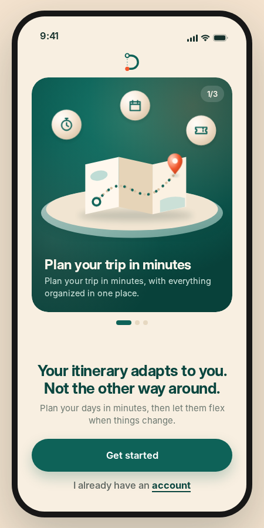

# Detour

An interactive mobile-app prototype for planning trips: pick your interests, get a day-by-day itinerary, and swap in alternative plans when the weather or closures get in the way.



## Features

- Onboarding flow with a 3-step intro carousel
- Personalized trip setup (interests, food preferences, travel style)
- Day-by-day itinerary with places, photos and map directions
- Alternative plans when it rains or a place is closed
- Shareable trip link
- Responsive: phone-frame mockup on desktop, full-screen on mobile

## Tech stack

- React (JSX, bundled to a single script)
- Plain CSS with design tokens (CSS variables)
- Inter font, self-hosted
- No backend, no build step needed to run it

## Getting started

It is a static site, so you only need to serve the folder.

```bash
git clone https://github.com/Alshaimaa00/detour.git
cd detour
npx serve .
# or: python3 -m http.server 8000
```

Then open the URL it prints (for example `http://localhost:3000`).

> You can also open `index.html` directly in a browser.

## Project structure

```
detour/
├── index.html          # Entry point
├── css/
│   ├── fonts.css       # @font-face declarations
│   └── styles.css      # App styles and design tokens
├── js/
│   └── app.js          # Bundled React app
├── fonts/              # Inter (400/500/600/700) + Inter Display 700
├── assets/images/      # Destination and activity photos
└── docs/
    └── screenshot.png
```

## Deploy

The project works on any static host. For GitHub Pages: **Settings → Pages → Deploy from a branch → `main` / root**.

## Author

Made by **Alshaimaa00**, [@Alshaimaa00](https://github.com/Alshaimaa00)

## License

[MIT](LICENSE)
